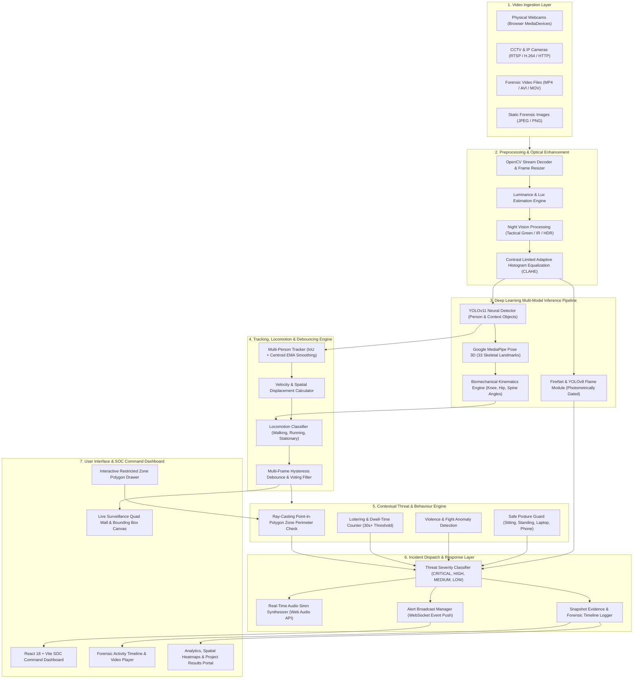
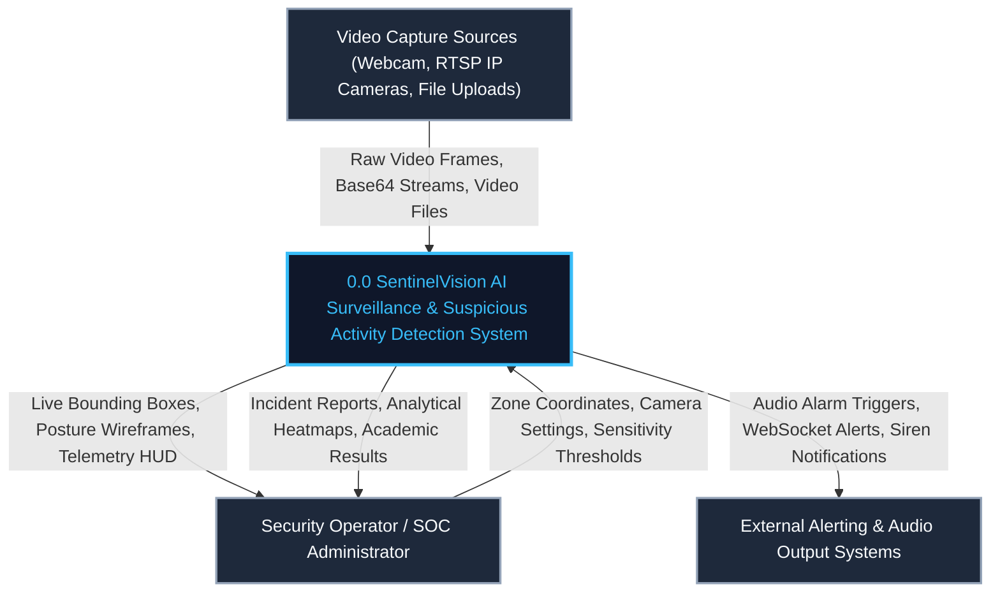
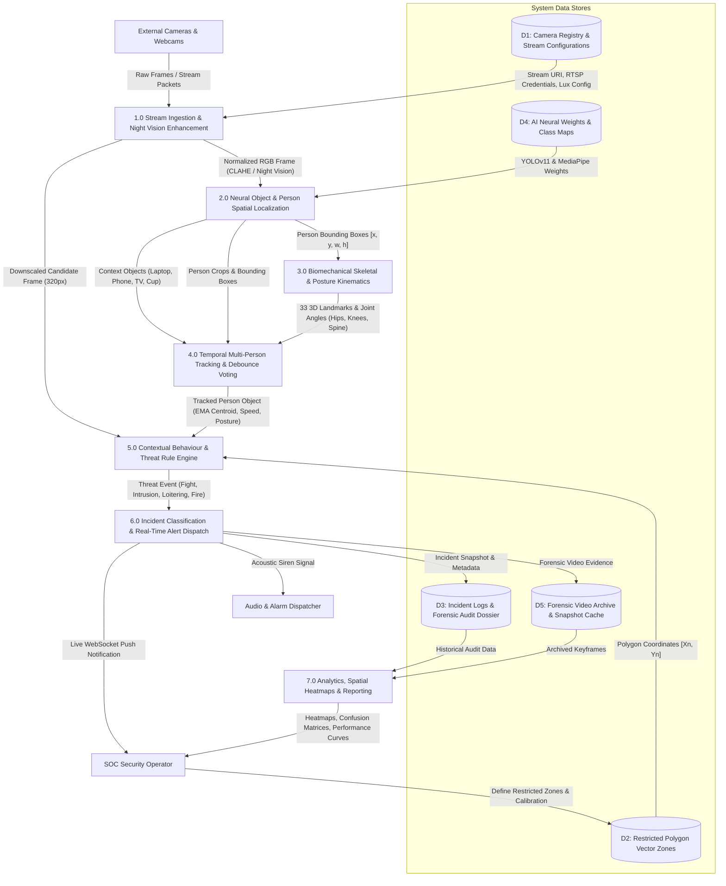
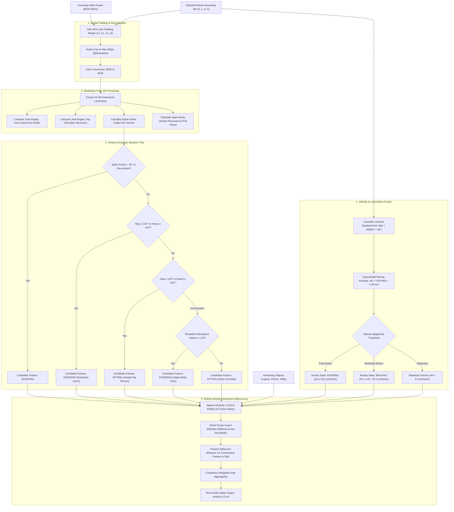
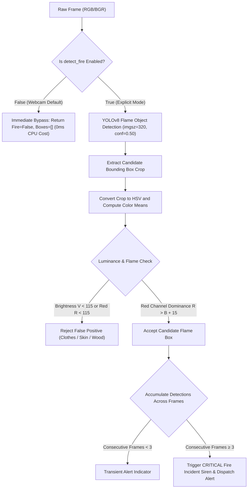
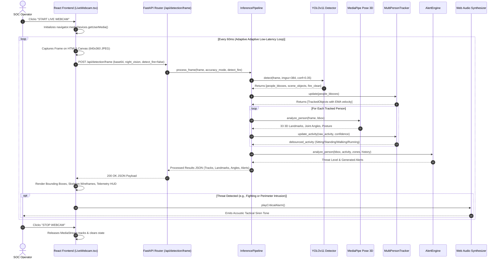

# SentinelVision AI: System Workflow & Data Flow Diagrams (DFD)
### Academic Project Report Documentation (Architecture & Engineering Design)

---

## 1. Executive Summary & Architecture Overview

The **AI Surveillance and Suspicious Activity Detection System (SentinelVision AI)** is an enterprise-grade intelligent video analytics architecture designed to process multi-channel surveillance feeds in real time. The platform integrates:
1. **YOLOv11** high-efficiency person and multi-object spatial localization.
2. **Google MediaPipe Pose 3D** biomechanical kinematic analysis (33 skeletal landmarks and joint angle evaluation).
3. **Calibrated Locomotion & Posture Engine** accurately differentiating `sitting`, `standing`, `walking`, `running`, `sleeping`, and device interactions without jitter.
4. **Hysteresis Debounce Filter** within temporal tracking to eliminate state flipping and single-frame flicker.
5. **Photometrically-Gated Fire & Flame Hazard Engine** combining deep neural classification with chromatic and luminance validation to reject false positives.
6. **Vector Polygon Ray-Casting & Spatial-Temporal Behaviour Engine** for perimeter intrusion, loitering, and violence detection.
7. **Real-Time SOC Command Center** built on FastAPI, React 18, TypeScript, and WebSockets.

---

## 2. High-Level End-to-End System Workflow Architecture

---

## 3. Data Flow Diagram (DFD) Level 0: Context-Level Diagram

The Level 0 DFD illustrates the boundary of the entire **SentinelVision AI System**, depicting external inputs, primary external entities (Surveillance Operator, Camera Stream Feeds, Physical Alarm Systems), and data exchanges.

---

## 4. Data Flow Diagram (DFD) Level 1: System Decomposition

The Level 1 DFD decomposes the system into 7 operational processes and 5 persistent data stores.

---

## 5. Data Flow Diagram (DFD) Level 2: Detailed AI Vision & Locomotion Pipeline

The Level 2 DFD details the exact transformations occurring within the **Deep Learning & Locomotion Classification** subsystem (Process 3.0 & 4.0), showing how raw frames are transformed into debounced, stable activity states without glitching.

---

## 6. Photometric Fire Hazard Detection Data Flow

This diagram documents the two-stage flame hazard pipeline that eliminates false positives on warm clothes, skin tones, and ambient lighting:

---

## 7. System Sequence Diagram: Live Client-Server Interaction

The sequence diagram below illustrates the real-time interaction between the Web Browser, FastAPI Backend, AI Pipeline, and Alert Engine during live surveillance monitoring:

---

## 8. Summary Table of Subsystem Specifications

| Subsystem Component | Framework / Technology | Primary Operational Function | Output Metric / Artifact |
| :--- | :--- | :--- | :--- |
| **Stream Ingestion** | OpenCV 4.8 / Web MediaDevices | Decodes RTSP, WebRTC, MP4, and JPEG frames at target dimensions. | Standard BGR matrix ($640 \times 360$ / $1280 \times 720$). |
| **Night Vision Engine** | Custom NumPy + CLAHE | Dynamic luminance sensor, lux estimation, and tactical green/IR filters. | Enhanced low-light frame + lux telemetry. |
| **Object & Person Detector** | YOLOv11-Nano (Ultralytics) | Spatial localization of people and everyday contextual objects. | Normalized bounding boxes $[x, y, w, h]$ with confidence. |
| **Biomechanical Engine** | Google MediaPipe Pose 3D | 33 3D skeletal landmark extraction and trigonometric joint angle computation. | Anatomical joint degrees (hip, knee, spine incline). |
| **Locomotion Engine** | Displacement Vector Math | Frame-to-frame centroid velocity with scale-invariant normalization. | Velocity (px/frame) and classified locomotion state. |
| **Temporal Debouncer** | Dwell-Time Hysteresis | 10-frame voting window with state-dwell locks to stop flip-flop jitter. | Stabilized activity tag (`sitting`, `standing`, `walking`, `running`). |
| **Fire Hazard Module** | YOLOv8 + HSV Chromatic Filter | Dual deep learning and photometric verification of incandescent flame. | Incandescent flame box + continuous alert flag. |
| **Behavior & Zone Engine** | 2D Vector Ray-Casting | Point-in-polygon intrusion testing, loitering counters, and violence checks. | Threat level (`NORMAL`, `SUSPICIOUS`, `CRITICAL`). |
| **Alert Engine** | Python Async Dispatcher | Thread-safe threat deduplication, audit persistence, and WebSocket broadcasting. | JSON Alert Payload + Evidence Snapshot. |
| **SOC Dashboard** | React 18, TypeScript, Tailwind | Live surveillance wall, forensic timeline, zone designer, and analytics. | Interactive Web Client HUD at 30+ FPS. |

---

## 9. Academic Report Inclusion Instructions

For inclusion in a formal thesis, capstone report, or conference submission:
1. **Chapter 3 (System Analysis & Requirement Specifications)**: Embed the **Level 0 and Level 1 Data Flow Diagrams (Section 3 & Section 4)** to illustrate procedural data interchange.
2. **Chapter 4 (System Architecture & Design)**: Embed the **High-Level System Workflow Diagram (Section 2)** and **Sequence Diagram (Section 7)** to demonstrate asynchronous service topology.
3. **Chapter 5 (Implementation & Algorithmic Modules)**: Embed the **Level 2 Locomotion & Posture Kinematic Flowchart (Section 5)** and **Photometric Fire Hazard Flowchart (Section 6)** to document the novel algorithmic contributions for zero-jitter posture classification and false-alarm suppression.
